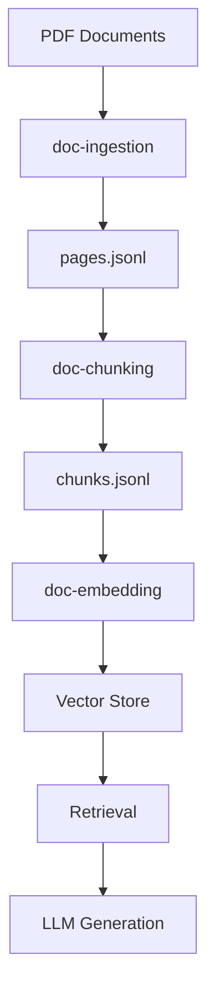
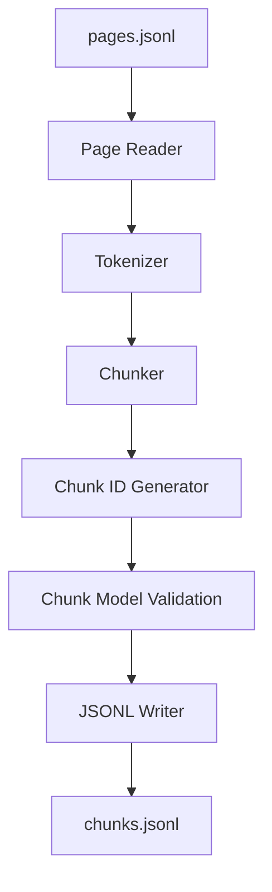
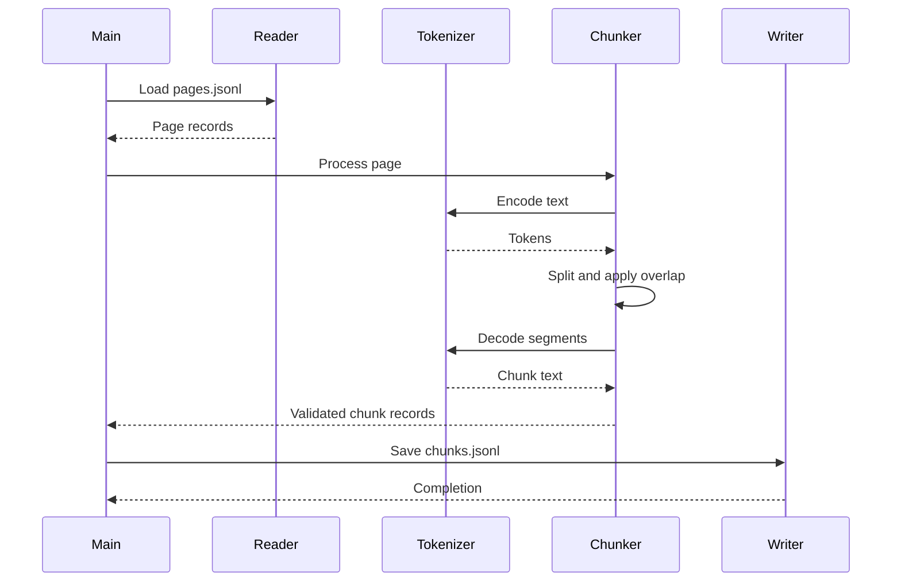

# doc-chunking

A document chunking component for a Retrieval-Augmented Generation (RAG) pipeline.

## 1. Purpose

`doc-chunking` consumes page-level text records produced by the `doc-ingestion` project and divides the extracted text into smaller, context-preserving segments called chunks.

These chunks will become the input for the embedding and vector-storage stages of the RAG pipeline.

## 2. Position in the RAG pipeline



## 3. Scope

### In scope

- Read page-level records from `pages.jsonl`.
- Split extracted text into smaller chunks.
- Use token-based chunk-size limits.
- Preserve paragraph boundaries where possible.
- Apply configurable overlap between adjacent chunks.
- Preserve document and page provenance.
- Generate deterministic chunk identifiers.
- Persist chunks as JSONL records.
- Validate chunking behavior through automated tests.

### Out of scope

- PDF extraction and OCR.
- Embedding generation.
- Vector database integration.
- Similarity search and retrieval.
- LLM-based answer generation.

These responsibilities belong to subsequent projects.

## 4. Initial design decisions

| Setting | Initial value |
|---|---|
| Target chunk size | 500 tokens |
| Overlap | 75 tokens |
| Boundary strategy | Paragraph-aware |
| Page boundaries | Chunks remain within one page |
| Tokenizer | `cl100k_base` initially |
| Output format | JSONL |
| Chunker version | 1.0 |

These values are initial engineering assumptions. They will be evaluated and adjusted when the embedding model and retrieval requirements are established.

The tokenizer is isolated behind a separate component so it can be replaced without changing the chunking algorithm.

## 5. Architecture



### Component responsibilities

| Component | Responsibility |
|---|---|
| `models.py` | Define and validate page and chunk data contracts |
| `config.py` | Centralize chunk size, overlap and tokenizer configuration |
| `tokenizer.py` | Encode and decode text using the selected tokenizer |
| `chunker.py` | Split text while preserving boundaries and overlap |
| `storage.py` | Read input pages and persist chunk records |
| `main.py` | Orchestrate the chunking workflow |

## 6. Sequence diagram



## 7. Project structure

```text
doc-chunking/
├── input/
│   └── pages.jsonl
├── output/
│   └── chunks.jsonl
├── src/
│   ├── __init__.py
│   ├── models.py
│   ├── config.py
│   ├── tokenizer.py
│   ├── chunker.py
│   ├── storage.py
│   └── main.py
├── tests/
│   ├── __init__.py
│   ├── test_models.py
│   ├── test_tokenizer.py
│   └── test_chunker.py
├── README.md
└── requirements.txt
```

## 8. Setup

Python 3.12 is the initial target environment.

Create and activate a virtual environment:

```bash
python -m venv .venv
.venv\Scripts\activate
```

Install dependencies:

```bash
python -m pip install -r requirements.txt
```

## 9. Implementation status

- [x] Project scope and boundaries defined.
- [x] Initial architecture and sequence diagrams documented.
- [ ] Data models and configuration.
- [ ] Tokenizer abstraction.
- [ ] Chunking algorithm.
- [ ] JSONL input and output.
- [ ] Unit and edge-case tests.
- [ ] End-to-end execution.
- [ ] Production hardening.

## 10. Testing

The project will use Python's `unittest` framework for unit tests.

Planned test coverage includes:

- Empty and whitespace-only pages.
- Text shorter than the configured chunk size.
- Text exceeding the chunk-size limit.
- Paragraph and sentence boundaries.
- Overlap between adjacent chunks.
- Deterministic chunk identifiers.
- Preservation of document and page provenance.
- Invalid configuration values.

Run the test suite from the project root:

```bash
python -m unittest discover -s tests -v
```

## 11. Known limitations

The initial implementation will not perform semantic chunking or understand document structure beyond paragraph boundaries. It will not merge content across PDF pages.

The initial tokenizer may not exactly match the tokenizer used by the eventual embedding model. This will be revisited during the embedding stage.

## 12. Next stage

The next project is `doc-embedding`.

It will consume `chunks.jsonl`, convert chunk text into numerical vectors, and preserve the chunk metadata required for retrieval and source attribution.